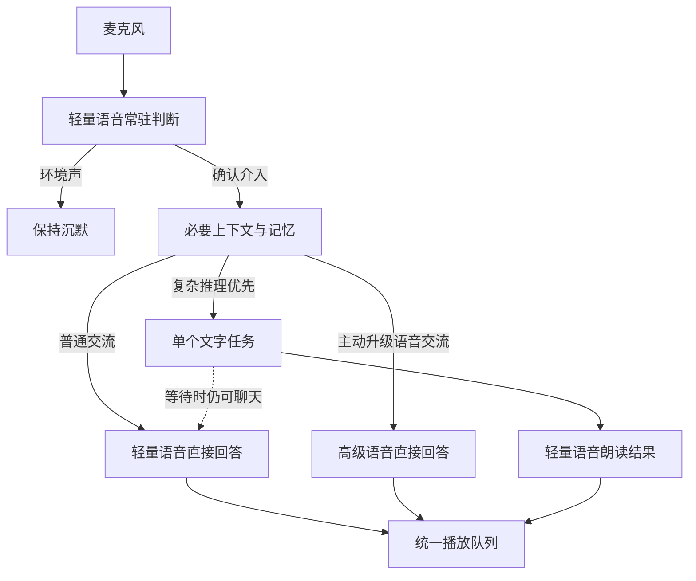

> 历史记录：以下描述 0.5.1 的现场排查与旧调度。当前行为以 PROJECT.md、VOICE_SCHEDULING_PLAN.md 和 docs/voice-capabilities.md 为准；高级接管后已经直接接收后续原生麦克风。

# 伴语：目标、精简架构与现场排查

## 软件目标

以低成本全天候陪伴为目标：判断用户是否在对助手说话，按问题选择轻量语音、高级语音或后台文字推理。后台处理时仍能交流，结果按顺序发声。应用为个人便携程序，未来设备独立联网直连模型，Windows 不承担其他设备的必需服务。

## 新的软件逻辑

配置只有三组模型。监听判断和日常发声使用同一个轻量模型的隔离会话：监听长期在线，输出只在获准发声时建立。这样既能持续过滤声音，也不会把长期记忆和完整历史带到每一次环境音判断里。

第一阶段只给轻量判断规则、两条有界的短对话线索、模型可用标志及当前任务标题；输出原话与去向。第二阶段才选择相关记忆、摘要、有效历史和必要的真实任务状态。普通回答由语音模型直接生成，不再另开文字分流会话。手动输入也经过同一套简短判断规则。

高级语音只收到批准后的文字和必要上下文，不收到原始环境音。新问题可中断正在生成的旧语音，迟到事件被丢弃；被打断的内容不会作为“用户已听过的回答”发给下一轮模型。当前实现不会把原声音的情绪、音色等非文字信息转交给高级模型。

默认路线是“轻量语音交流 + 文字后台推理”。高级语音作为主动选择的深入语音交流模式，选择可延续；只要文字任务仍在运行，前台临时使用轻量语音陪伴，不启动高级语音重复解同一题。文字未配置或未启用但高级语音可用时，复杂问题单独交给高级语音，本轮结束不改变默认模式。不会因文字接口429/500自动另开一个模型重做问题。

后台文字任务最多一个，每个任务一次 HTTP 请求，无工具回合或自动重试。新条件明确关联当前任务时取消旧请求，按合并后的问题重新处理；普通闲聊不会重发任务。等待时只说一次简短衔接，后续交流由用户发起，完成结果进入同一个播放队列。失败详情留在任务栏，不把几十秒的接口诊断整段朗读出来。

交接只有三条约束：同一问题一个推理负责人；同一时刻一个播报；新结果只在用户介入判断完成、前台生成和实际播放回执均结束后开始。环境音被忽略就继续播放队列；确认新指令后再打断旧语音。取消同时清除排队结果，修订只替换对应任务，不保留其过期播报。没有周期陪聊、自动催促或失败重试。

0.5.1 的专项修复还包括：任务重播明确选最终正文，过渡语不再标作任务结果；Gemini 的模型 turnComplete 不再误报用户 speechEnd；千问连接主动结束同时清理握手等待，关闭后的错误不再反复冒泡。任务控制由多任务 Map 改为一个槽，前台模型上下文只附当前运行问题，移除无关的旧任务错误。播放回执编号用完即清理，迟到的重复回执不能覆写已确认的播放状态。

## 模块为什么存在

| 模块 | 责任 | 服务的目标 |
|---|---|---|
| assistant.ts | 是否参与、选模型、后台任务、打断与交接 | 三个模型的智能调度 |
| providers.ts、voice/ | 厂商协议与一次模型调用 | 两个语音槽位均可选择厂商 |
| context.ts、store.ts | 必要上下文、明文记忆、精简历史 | 连贯对话与个人记忆 |
| playback.ts、renderer.ts | 一个声卡播放通道、后台恢复、回执 | 真实发声与避免串音 |
| requests.ts、api-errors.ts | 逐次计数、真实错误、429冷却 | 排查请求问题并防止自动重试放大 |
| billing.ts | 三组独立的已报告用量计价 | 全天候成本可见 |
| main.ts | Windows 窗口、托盘、音频进程生命周期 | 桌面载体 |

## 删除的功能和逻辑

独立 planner 及其大型 JSON 回答协议；日期和算式等本地意图补丁；自动纠正模型回答的成片规则；最多三轮的本地工具调用；额外 Tavily 搜索服务；每16轮自动整理；8秒自动催促；离线假对话演示；高级模式空闲切换计时。手动摘要、基本记忆编辑、取消/清空任务及必要播放状态继续保留。

## 上传日志证明了什么

以下时间均为上海时间，来自本次 personal.zip 的 logs/ 和 requests/。

| 时间 | 现场事实 | 能确定的结论 |
|---|---|---|
| 18:56:52.783 → 18:56:56.473 | 文字任务第1次请求返回429；同站近60秒仅1次开始记录 | 该次不能归因为本机已在一分钟发送10次请求；没有本机自动重试 |
| 19:37:05.865 → 19:37:08.798 | 同千问入口、同 qwen3.8-omni-flash-realtime 先有正常生成与已听回执 | 语音并非所有调用都完全失效 |
| 19:37:16.295 → 19:37:36.400 | 握手成功并发起生成，约20.1秒后50002，无 response.created 或已听音频 | 失败发生于模型响应开始之前，不是本机收到了正常音频却没播 |
| 19:38:30.758 → 19:38:50.853 | 再次约20.1秒后相同 ModelServingError | 是重复出现的云端生成失败，但日志没有完整输入确认/参数，尚不能断言唯一服务端根因 |

整份请求日志中，文字站点任何60秒窗口最多1次记录，语音站点最多6次握手。统计覆盖这份上传日志；不代表服务端账户总计，也不代表其他未记录的客户端。

原客户端还存在一项协议时序缺口：文本对话项发送后立即请求生成，没有等待服务端确认。0.5.0 等待匹配的文本确认、忽略无关/重复确认，只发一次生成；失败保留原文并结束当前输出，不自动重发。日志新增输入创建/确认和来源信息，仍不记录请求正文或密钥。

以上是“已确认事实”和“已修改的软件缺口”。本次上传没有配置或密钥，无法用用户实际云端账户复验，因此不能宣称429或50002已被彻底根治。

## 验收边界

自动测试检验四种协议、16种模型搭配、先判断后读取记忆、后台一次请求、伴随聊天、播放顺序、50002无自动重试、旧问题的迟到决策及暂停重播。桌面验证检查实际音频图与回执，包括最小化、隐藏窗口和故障后的继续对话。模拟服务不能验证供应商推理兼容性、环境音识别质量或 Windows 实机声卡；这些仍需要实际使用验证。
