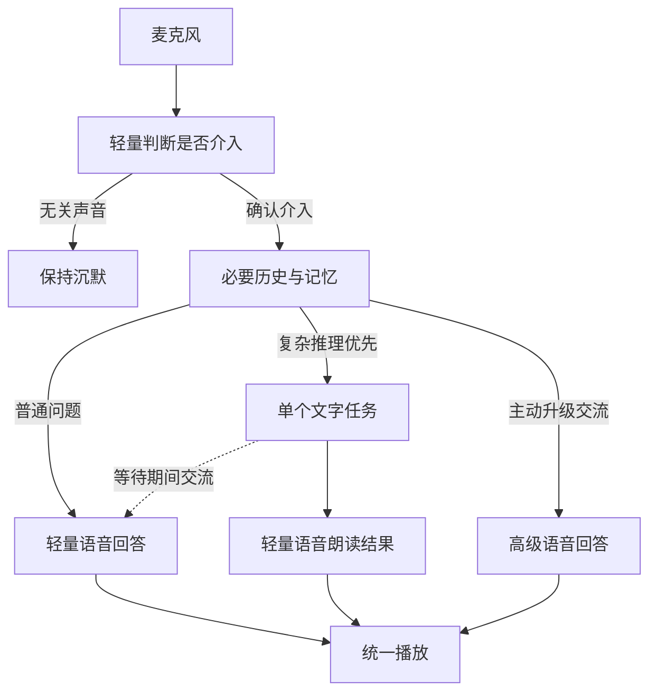

# Evernear · 伴语

> 项目说明与开发接续入口。当前软件版本：0.5.1。继续开发先读本文件，再按需要读代码，不必重读全部历史会话。

## 项目目标

一个轻量、个人使用、全天候在线的语音助手：像身旁的助手一样，在确实需要参与时自然接话。普通问题快速响应，复杂问题也能解答，后台思考时仍能继续交流。

当前平台为 Windows x64；未来迁移到手机或 ESP32 等设备。每台设备应独立联网访问模型，不依赖 Windows 电脑中转。移动端及 ESP32 的录音、播放和协议适配尚未实现。

核心始终是 **两个语音模型槽位、一个文字模型槽位之间的智能调度**。没有账号系统、独立服务端或强制云同步。填写接口地址、密钥、模型和音色即可使用。

## 模型分工

| 槽位 | 职责 | 边界 |
|---|---|---|
| 轻量语音 | 持续判断是否介入、普通回答、等待期间交流、朗读文字结果 | 原始麦克风只送这一槽位；环境声不进入有效历史 |
| 高级文字 | 复杂计算、多步推理、文字分析；按用户操作整理较早历史 | 同时最多一个后台推理任务，每个任务一次请求，不自动重试 |
| 高级语音 | 用户主动选择的深入语音交流；文字未启用时独立解答复杂问题 | 只接收批准后的文字与必要上下文，不重复处理运行中的文字任务 |

轻量语音必需，高级语音和文字按需配置。不同用途会建立隔离会话，这些会话不是新增模型槽位。高级语音当前不接收原声音色、情绪等非文字信息。



## 调度约束

1. **先判断，再加载上下文。** 第一阶段只有判断规则、最近两条短对话线索、模型可用性和运行任务标题；确认介入后，才加载必要历史、摘要及相关记忆。
2. **一个问题一个推理负责人。** 复杂问题默认交给文字模型。运行期间，无论是否选择过高级语音，前台统一用轻量语音交流，不让高级语音再算同一问题。
3. **陪伴不等于定时插话。** 开始任务时可有一次短衔接；之后可以闲聊或澄清条件，不循环播报“还在思考”，不编造进度和完成时间。
4. **结果自然接话。** 等用户说话和介入判断结束、当前前台回答生成和实际播放结束后，再播报后台结果。生成结束不等于用户已经听到。
5. **修订和取消有效。** 明确补充同一问题时取消旧任务，合并条件再处理；普通闲聊、询问进度不重发任务。取消撤下排队结果，过期请求的迟到结果不播报。
6. **环境音没有控制权。** 只有常驻轻量会话能批准新输入；环境声不能直接触发高级模型、取消任务或写入记忆。被打断或污染的输出会话丢弃，下次重建有效上下文。
7. **播放以回执为准。** 只有确认播放的回答作为已听历史；失败保留文字供手动重播。同次播放回执只消费一次，迟到回执不能覆写状态。

以上是代码约束，不代表已在真实环境验证每一次语义判断都准确。

## 个人文件与记忆

个人内容都放在程序旁边的 `personal/`，允许明文保存。分享、提交仓库时排除整个目录；升级时保留它。

| 文件 | 内容 |
|---|---|
| `config.json` | 三组模型配置、凭据、必要偏好与价格 |
| `memory.md` | 个人事实和长期记忆，可直接编辑 |
| `instructions.md` | 用户行为偏好与固定指令 |
| `history/` | 每条只保留角色、时间、正文 |
| `session.json` | 当前会话、任务和播放状态 |
| `logs/`、`requests/` | 独立诊断信息，不作为日常对话正文 |

系统提示、路由原因、接口参数、播放状态和用量不重复塞进历史。获准回答后才带相关记忆、近期有效对话及必要真实状态；较早内容可摘录压缩，也可由用户主动调用文字模型生成摘要，不按每段环境音调用记忆模型。

## 代码结构

| 文件 | 职责 |
|---|---|
| `src/assistant.ts` | 介入、分流、单个后台任务、打断和交接 |
| `src/providers.ts`、`src/voice/` | 文字请求及厂商语音协议 |
| `src/context.ts`、`src/store.ts` | 有界上下文、明文记忆及历史 |
| `src/playback.ts`、`src/renderer.ts` | 播放、设备、界面和回执 |
| `src/requests.ts`、`src/api-errors.ts` | 请求计数、错误来源和冷却 |
| `src/billing.ts` | 三组模型独立计价及实际用量统计 |
| `src/main.ts` | Electron 窗口、托盘和进程生命周期 |

当前代码适配 Qwen Realtime、OpenAI Realtime、Gemini Live、Doubao 实时语音；两个语音槽位可分别选择厂商。文字使用 OpenAI Chat Completions 兼容格式的超文本传输协议（HTTP）接口。语音和文字接口分开配置，文字专用模型不能直接当作实时语音模型。

## 开发与打包

使用 Node.js 22 或以上、npm、TypeScript 和 Electron。

```bash
npm ci
npm test
npm start
```

首次安装需要下载依赖和 Electron。`npm test` 编译后执行本地单元和协议测试，不需要真实模型凭据。运行会生成本地 `personal/`，不需要在源码里放入个人配置。

```bash
npm run package:win
```

Windows x64 便携构建输出到 `release/`，推荐在 Windows 上制作并验收 Windows 包。二进制分发放 GitHub Releases，不提交源码分支。桌面检查脚本为 `scripts/smoke-electron.mjs` 和 `scripts/smoke-voice-matrix.mjs`，另需 Playwright 自动化依赖及可运行 Electron 的环境，不包含在 `npm test` 中。

## 当前状态与验证边界

0.5.1 已实现三模型调度、两阶段上下文、明文个人目录、三组价格、任务取消/清空、手动摘要与重播。最小化或隐藏窗口时应继续听说；暂停停止麦克风采集和上传。电脑睡眠、断网期间不能调用云端。

交付记录：**106 项单元及协议测试通过**，包含新增 8 项交接回归、16 种语音搭配；最终程序包通过 8 项桌面核心检查和四厂商桌面矩阵，界面运行错误为 0。详见 `QA.json`。

测试使用本地模拟接口和假麦克风，在 Linux Electron 上完成。真实云端兼容性与限额、Windows 声卡、全天运行、环境介入准确率和自然交接仍待实测。不能据此宣称云端 HTTP 429 或千问 50002 已根治。本次仓库准备只改文档及忽略规则，没有改动应用源码，也没有重新进行实机验收。

## 下一步

1. Windows 实测基本听说、最小化播放、设备切换及故障后继续交流。
2. 实测后台推理时的闲聊、补充条件、取消及结果恰好返回；依据可复现问题做小范围修正。
3. 验证环境音过滤与全天成本，桌面稳定后再迁移手机或 ESP32。

暂不引入账号、数据库、服务端集群、多智能体框架、工具循环、自动搜索、周期陪聊或 Windows 本机朗读替代。没有目标和实测问题支撑的功能不加入。

## GitHub 接续

正式源码仓库：[CaiKerman/Evernear](https://github.com/CaiKerman/Evernear)，主分支为 `main`。从该分支继续开发，以 Git 提交记录为准；`README.md` 为使用入口，`AGENTS.md` 为修改约束，本文件为项目接续入口。

`personal/`、密钥文件、录音、日志、依赖和构建产物不提交。二进制需要分发时放 GitHub Releases。尚未指定开源许可证，不代选许可证或改变仓库可见性。

获取新工作目录：

```bash
git clone https://github.com/CaiKerman/Evernear.git
cd Evernear
npm ci
```

修改前核对远程最新提交，保留已有历史，不强制覆盖。准备包仅作为首次导入前的恢复资料，后续源码以仓库最新提交为准。
